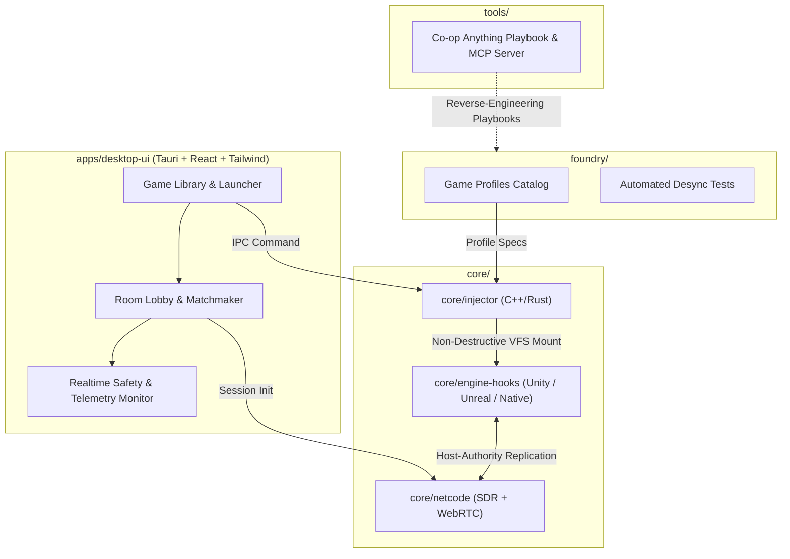

# Duoverse

> **Instant, non-destructive co-op multiplayer for your installed single-player PC games.**

[](LICENSE)
[-informational)](https://github.com/Zehna/duoverse)
[](.antigravity/rules.md)

---

## What is Duoverse?

**Duoverse** is an open-source desktop launcher and runtime injection platform designed to turn single-player PC games into seamless cooperative multiplayer experiences. 

Instead of requiring fragile game file modifications, opening router ports, or relying on clumsy virtual LAN setups, Duoverse uses **in-memory injection**, **Virtual File System (VFS) redirection**, and **Steam Datagram Relay (SDR)** to enable instant drop-in multiplayer using a simple 6-character Room Code.

---

## Architecture Overview



---

## The 4 Strict Architectural Principles

All development in this repository is strictly governed by [`.antigravity/rules.md`](.antigravity/rules.md):

1. **Non-Destructive Modding (Critical):** Original game files on disk are **never** modified or overwritten. All patches occur in-memory via trampoline hooks (MinHook/Detours) or Virtual File System (VFS) redirection.
2. **Host-Authority Network Topology:** Player 1 (Host) is the authoritative simulation master for enemy AI, physics, and quest state. Client instances stream local inputs and render interpolated avatars.
3. **Automated Anti-Cheat Detection:** The PE analyzer scans target binaries for kernel anti-cheat systems (Easy Anti-Cheat, BattlEye, Vanguard). If detected, injection is automatically aborted before process launch.
4. **Zero-Port Forwarding:** Connections prioritize 6-character room codes via **Steam Datagram Relay (Spacewar AppID 480)** or WebRTC NAT traversal, requiring zero manual router configuration.

---

## Monorepo Layout

```
.
├── .antigravity/          # Agent architecture rules & system prompt configurations
│   └── rules.md           # Mandatory architectural principles & safety policies
├── .mcp.json              # Co-op Anything MCP server integration
├── apps/
│   └── desktop-ui/        # Tauri + React + Tailwind CSS launcher application
├── core/
│   ├── injector/          # C++/Rust PE binary inspector, memory hook engine, & VFS
│   ├── engine-hooks/      # Engine-specific hook templates (Unity BepInEx/Mono)
│   └── netcode/           # P2P sync protocol, 6-digit lobby, & SDR/WebRTC wrappers
├── foundry/               # Game profiles catalog & automated desync testing suites
│   ├── profiles/          # Declarative JSON game profiles
│   └── tests/             # Profile validation & network simulation tests
└── tools/
    └── coop-anything/     # Reference playbook & MCP server (submodule)
```

---

## Quickstart

### Prerequisites
- Node.js 20+ & npm / pnpm
- Rust toolchain (`cargo`, `rustc`)
- Python 3.9+ (with PyYAML for MCP and Foundry tests)
- C++20 compatible compiler & CMake 3.20+

### Validating Foundry Profiles
```bash
python3 foundry/tests/test_profile_validation.py
```

### Running the Desktop UI
```bash
cd apps/desktop-ui
npm install
npm run tauri dev
```

---

## License

This project is licensed under the [MIT License](LICENSE).
