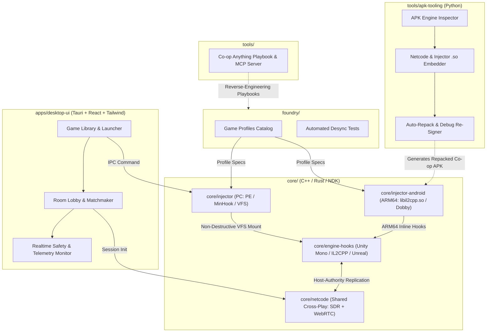

# Duoverse

> **Instant, non-destructive co-op multiplayer for installed single-player PC & Android games with seamless Cross-Play.**

[](LICENSE)
[-informational)](https://github.com/Zehna/duoverse)
[](core/netcode)
[](.antigravity/rules.md)

---

## What is Duoverse?

**Duoverse** is an open-source multi-platform launcher and runtime injection ecosystem designed to turn single-player PC and Android games into cooperative multiplayer experiences.

Instead of permanently altering game installations on disk or device storage, Duoverse uses **in-memory injection**, **Virtual File System (VFS) redirection**, and **unified P2P netcode** to enable instant drop-in multiplayer using a simple 6-character Room Code.

### Cross-Play Ready (PC & Android)
A Player on PC (Windows) and a Player on Mobile (Android) can join the **exact same room lobby** (e.g. `DUO-7K2`). Duoverse's shared netcode automatically aligns binary packet formats and bridges connections over Steam Datagram Relay (PC) and WebRTC Data Channels (Mobile).

---

## Architecture Overview



---

## The 4 Strict Architectural Principles

All development in this repository is strictly governed by [`.antigravity/rules.md`](.antigravity/rules.md):

1. **Non-Destructive Modding (Critical):** Original game files on disk or phone storage are **never** permanently modified. PC utilizes in-memory injection and VFS redirection; Android utilizes isolated APK repacking (`tools/apk-tooling`) without requiring device root.
2. **Host-Authority Network Topology & Cross-Play:** Player 1 (Host) is the authoritative simulation master for enemy AI, physics, and world state. Client instances (PC or Android) stream inputs and render interpolated avatars.
3. **Automated Anti-Cheat & Tamper Detection:** Scans PE binaries on PC (EAC, BattlEye, Vanguard) and APK packages on Android (Tencent ACE, NetEase Sec, XIGNCODE3). Injection/repacking is automatically aborted if anti-cheat is detected.
4. **Zero-Port Forwarding & Unified Lobbies:** Connections prioritize 6-character room codes via **Steam Datagram Relay (Spacewar AppID 480)** for PC peers and **WebRTC Data Channels** for mobile and cross-play peers.

---

## Monorepo Layout

```
.
├── .antigravity/              # Agent architecture rules & system prompt configurations
│   └── rules.md               # Mandatory architectural principles & safety policies
├── .mcp.json                  # Co-op Anything MCP server integration
├── apps/
│   └── desktop-ui/            # Tauri + React + Tailwind CSS launcher application
├── core/
│   ├── injector/              # Windows PC PE inspector, memory hook engine, & VFS
│   ├── injector-android/      # Android ARM64 IL2CPP hook module & JNI bridge
│   ├── engine-hooks/          # Engine-specific hook templates (Unity BepInEx / Mono)
│   └── netcode/               # Shared cross-platform netcode (.dll / .so) & cross-play lobby
├── foundry/                   # Game profiles catalog & automated desync testing suites
│   ├── profiles/              # Declarative JSON game profiles
│   └── tests/                 # Profile validation & network simulation tests
└── tools/
    ├── apk-tooling/           # Android APK analyzer, runtime embedder, and auto-repacker
    └── coop-anything/         # Reference playbook & MCP server (submodule)
```

---

## Quickstart

### Prerequisites
- Node.js 20+ & npm / pnpm
- Rust toolchain (`cargo`, `rustc`)
- Python 3.9+ (with PyYAML for MCP and Foundry tests)
- C++20 compatible compiler & CMake 3.20+
- (Optional for Android) Android NDK r25+ and `apksigner`

### 1. Validating Foundry Game Profiles
```bash
python3 foundry/tests/test_profile_validation.py
```

### 2. Testing Cross-Platform Netcode Simulation
```bash
python3 foundry/tests/test_desync_fuzzer.py
```

### 3. Testing APK Tooling & Repack Pipeline
```bash
python3 tools/apk-tooling/test_pipeline.py
```

### 4. Running the Desktop UI
```bash
cd apps/desktop-ui
npm install
npm run tauri dev
```

---

## License

This project is licensed under the [MIT License](LICENSE).
